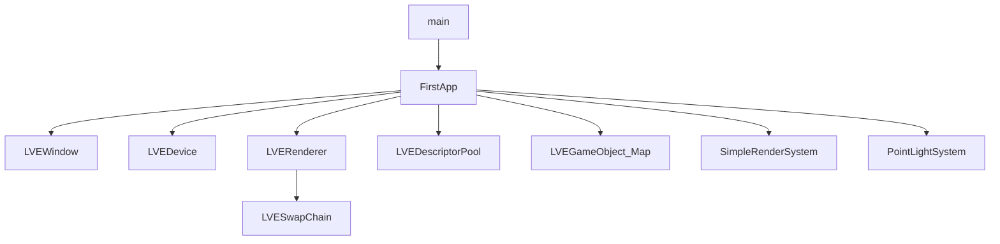
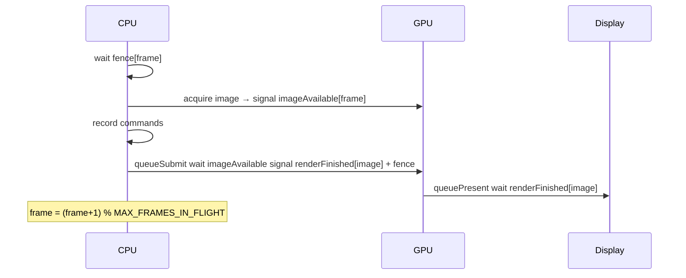

# LittleVulkanEngine 代码导读（生疏回顾版）

面向「很久没碰 Vulkan、几乎每行枚举/参数都陌生」的读者。  
建议：**先扫本文概念 → 再对着源码看注释**；源码里的行内注释会解释「这个枚举/字段在本工程里为什么这样设」。

源码：[`LittleVulkanEngine/`](../LittleVulkanEngine/)  
第三方：[`modules/`](../modules/)（GLFW / GLM）

---

## 0. 先建立心智模型（比记 API 名更重要）

### OpenGL 习惯 vs Vulkan

| OpenGL 直觉 | Vulkan 现实 |
|-------------|-------------|
| 调 `glDraw` 就画了 | 只是把命令**录进** Command Buffer，真正执行在 `vkQueueSubmit` 之后 |
| 绑定纹理/UBO 改全局状态 | 几乎一切通过 **Pipeline / Descriptor / Push Constant** 显式声明 |
| 驱动帮你同步 | **Fence（CPU↔GPU）**、**Semaphore（GPU 队列间）** 自己管 |
| 窗口 resize 无所谓 | 交换链常失效 → `OUT_OF_DATE` → 整链重建 |

### 本工程一帧在干什么（一句话）

> CPU 填好本帧的矩阵和灯光 → 向 GPU **录制**「画网格 + 画光点」命令 → **提交**给队列 → **呈现**到窗口。

### 句柄（Handle）是什么

Vulkan 里 `VkXxx` 多数是**不透明句柄**（像 ID），不是 C++ 对象。  
创建：`vkCreateXxx(..., &handle)`；销毁：`vkDestroyXxx(device, handle, nullptr)`。  
本工程用 `LVE*` 类包一层，方便 RAII。

### 到处出现的 `sType`

几乎每个 `Vk*CreateInfo` / `Vk*Info` 第一个字段都是：

```cpp
info.sType = VK_STRUCTURE_TYPE_XXXX;
```

作用：告诉驱动「这块内存是哪种结构」。漏写或写错 → validation 报错或崩溃。  
`pNext`：扩展链，本教程多为 `nullptr`。

---

## 1. 项目定位与依赖

| 依赖 | 用途 |
|------|------|
| Vulkan SDK | API + `glslc` 编译着色器 |
| GLFW | 窗口、输入；`GLFW_NO_API` 表示不要 OpenGL 上下文 |
| GLM | 矩阵；`GLM_FORCE_RADIANS`、`GLM_FORCE_DEPTH_ZERO_TO_ONE`（深度 [0,1]，对齐 Vulkan） |
| tiny_obj_loader | 读 `.obj` |

能力链：窗口/Surface → Instance/Device → SwapChain/RenderPass/同步 → Pipeline → Buffer/Model → Descriptor/UBO → 相机/场景 → 网格渲染 + 点光 Billboard。

---

## 2. 模块一览（读哪个文件）

| 文件 | 职责 | 生疏时优先看什么 |
|------|------|------------------|
| `main.cpp` | 入口 | `FirstApp::run()` |
| `first_app.*` | 组装 + 主循环 | UBO/描述符创建；一帧 update→render |
| `lve_window.*` | GLFW + Surface | `framebufferResized` |
| `lve_device.*` | Instance/设备/队列/CommandPool | 构造顺序；`createBuffer` |
| `lve_swap_chain.*` | 交换链全套 + 同步 | `acquire`/`submit`；RenderPass 附件枚举 |
| `lve_renderer.*` | begin/end Frame | `currentFrameIndex` vs `currentImageIndex` |
| `lve_pipeline.*` | SPIR-V + 固定功能状态 | `defaultPipelineConfigInfo` 每个字段 |
| `lve_buffer.*` | map/write/flush | `HOST_VISIBLE` vs `DEVICE_LOCAL` |
| `lve_model.*` | 顶点布局 + staging 上传 | `location` 与 shader 对齐 |
| `lve_descriptors.*` | Layout/Pool/Writer | binding / type / stageFlags |
| `lve_frame_info.h` | `GlobalUbo` / `FrameInfo` | 与 GLSL 字段一一对应 |
| `simple_render_system.*` | 画网格 | bind descriptor → push → draw |
| `point_light_system.*` | 写灯光 + Billboard | 无顶点缓冲、`gl_VertexIndex` |

---

## 3. 对象所有权与构造顺序

`FirstApp` **声明顺序 = 析构逆序**：

`Window → Device → Renderer → globalPool → gameObjects`



**Device 构造顺序（必须）：** Instance → DebugMessenger → Surface → 选 GPU → LogicalDevice → CommandPool  

**SwapChain::init()：** SwapChain → ImageViews → RenderPass → Depth → Framebuffers → SyncObjects  

---

## 4. 帧循环与同步（最易混）

### 4.1 主循环步骤（`FirstApp::run`）

1. 输入 → 更新相机  
2. `beginFrame`：等 fence → **acquire** 一张 swap image → `vkBeginCommandBuffer`  
3. 填 `GlobalUbo` → `writeToBuffer` + `flush`（CPU→可见给 GPU）  
4. `beginSwapChainRenderPass` → 网格 → 点光 → `endSwapChainRenderPass`  
5. `endFrame`：`vkEndCommandBuffer` → **submit** → **present** → 帧槽 +1  

### 4.2 两个索引（必背）

| 名字 | 含义 | 用来索引什么 |
|------|------|----------------|
| `currentFrame` / `frameIndex` | CPU「第几个飞行帧槽」 | fence、`imageAvailable`、commandBuffer、每帧 UBO/descriptor |
| `currentImageIndex` | 交换链里哪张图 | Framebuffer、颜色附件、**`renderFinished` semaphore** |

二者**无关**：帧槽常为 2；swap 图像常为 2～3 张。`renderFinished` 必须按 **imageIndex** 索引：present 会占用该 semaphore，直到该图再次 acquire；旧教程按帧槽复用会在 Mailbox/三缓冲上触发校验层报错甚至卡死。

完整排查过程（现象 → 读 validation → 根因 → 修法）：见 [`SWAPCHAIN_SEMAPHORE_REUSE.md`](./SWAPCHAIN_SEMAPHORE_REUSE.md)。

### 4.3 一帧同步时序



| 对象 | 谁等谁 | 本工程用法 |
|------|--------|------------|
| Fence | **CPU** 等 **GPU** | `inFlightFences[frame]`；创建时 `SIGNALED`，否则首帧死等 |
| Semaphore | **GPU** 上两步之间 | `imageAvailable[frame]`：acquire→可画；`renderFinished[image]`：画完→可 present |
| `imagesInFlight[image]` | 同一张图别被两帧同时用 | 存「占用该 image 的那个 frame 的 fence」 |

### 4.4 常见返回值

| 结果 | 含义 | 本工程处理 |
|------|------|------------|
| `VK_SUCCESS` | 正常 | 继续 |
| `VK_SUBOPTIMAL_KHR` | 还能用但不理想 | 本帧可继续，随后重建 |
| `VK_ERROR_OUT_OF_DATE_KHR` | 交换链失效（常见于 resize） | 立即 `recreateSwapChain`，本帧可跳过 |

---

## 5. 本工程常见枚举/参数速查

读代码时把这一节当词典。

### 5.1 内存属性 `VkMemoryPropertyFlags`

| 标志 | 含义 | 本工程哪里用 |
|------|------|----------------|
| `HOST_VISIBLE` | CPU 可 map 写入 | UBO、staging |
| `HOST_COHERENT` | 写完不必手动 flush（仍可 flush） | staging |
| `DEVICE_LOCAL` | GPU 本地，快；CPU 通常不能直接写 | 顶点/索引、深度图 |

模式：**CPU 写 staging → `vkCmdCopyBuffer` → DEVICE_LOCAL**。

### 5.2 缓冲用途 `VkBufferUsageFlags`

| 标志 | 含义 |
|------|------|
| `UNIFORM_BUFFER` | 着色器里的 UBO |
| `VERTEX_BUFFER` | 顶点 |
| `INDEX_BUFFER` | 索引 |
| `TRANSFER_SRC` / `TRANSFER_DST` | 拷贝源/目标 |

### 5.3 图像用途 / Layout（交换链与深度）

| 枚举 | 含义 |
|------|------|
| `VK_IMAGE_USAGE_COLOR_ATTACHMENT_BIT` | 当作颜色渲染目标 |
| `VK_IMAGE_USAGE_DEPTH_STENCIL_ATTACHMENT_BIT` | 深度附件 |
| `VK_IMAGE_LAYOUT_UNDEFINED` | 不关心旧内容（可丢弃） |
| `VK_IMAGE_LAYOUT_COLOR_ATTACHMENT_OPTIMAL` | 正在作为颜色附件写 |
| `VK_IMAGE_LAYOUT_PRESENT_SRC_KHR` | 可以拿去 present |
| `VK_IMAGE_LAYOUT_DEPTH_STENCIL_ATTACHMENT_OPTIMAL` | 深度读写 |

RenderPass 的 `initialLayout` → `finalLayout` 描述「这一趟结束后图像处于何种布局」。

### 5.4 附件 Load/Store

| 枚举 | 含义 |
|------|------|
| `LOAD_OP_CLEAR` | 开始时清成 clearValue |
| `LOAD_OP_LOAD` | 保留旧内容 |
| `STORE_OP_STORE` | 结束后保留（颜色要显示 → STORE） |
| `STORE_OP_DONT_CARE` | 结束后不要了（深度常这样） |

### 5.5 呈现模式 `VkPresentModeKHR`

| 模式 | 行为 |
|------|------|
| `FIFO` | 垂直同步队列，**必支持** |
| `MAILBOX` | 三缓冲式，低延迟，本工程优先选 |
| `IMMEDIATE` | 可能撕裂 |

### 5.6 表面格式

本工程优先：`VK_FORMAT_B8G8R8A8_SRGB` + `VK_COLOR_SPACE_SRGB_NONLINEAR_KHR`  
（显示用 sRGB；与线性 `UNORM` 的区别见源码旁注。）

### 5.7 队列共享

| `imageSharingMode` | 何时 |
|--------------------|------|
| `EXCLUSIVE` | 图形队列族 == 呈现队列族（常见） |
| `CONCURRENT` | 两族不同，需列出两个 family 索引 |

### 5.8 管线里常看到的

| 枚举/字段 | 本工程默认 | 白话 |
|-----------|------------|------|
| `TRIANGLE_LIST` | 是 | 每 3 个顶点一个三角形 |
| `CULL_MODE_NONE` | 是 | 不剔背面（教学省事） |
| `FRONT_FACE_CLOCKWISE` | 是 | 顺时针为正面 |
| `depthCompareOp = LESS` | 是 | 更近的片元留下（深度 0 近 1 远） |
| 动态 `VIEWPORT`/`SCISSOR` | 是 | 每帧用 `vkCmdSet*` 设，resize 不用重建管线 |
| Alpha：`SRC_ALPHA` / `ONE_MINUS_SRC_ALPHA` | 点光 | 标准透明混合 |

### 5.9 描述符

| 概念 | 白话 |
|------|------|
| Set Layout | 「这个 set 里 binding0 是 UBO、谁能读」的**图纸** |
| Pool | 按类型预留额度，从中**分配** set |
| Set | 图纸的一次实例，真正指向某个 Buffer |
| `VK_DESCRIPTOR_TYPE_UNIFORM_BUFFER` | UBO |
| `VK_SHADER_STAGE_ALL_GRAPHICS` | vert+frag 等图形阶段都能读 |
| binding 号 | 必须等于 GLSL `layout(binding=N)` |

### 5.10 命令相关

| 枚举 | 含义 |
|------|------|
| `PRIMARY` command buffer | 可直接 submit |
| `VK_SUBPASS_CONTENTS_INLINE` | 二次命令缓冲不嵌套，命令直接写在 primary 里 |
| `VK_PIPELINE_BIND_POINT_GRAPHICS` | 绑的是图形管线（不是计算） |
| `VK_PIPELINE_STAGE_COLOR_ATTACHMENT_OUTPUT_BIT` | 等到「写颜色附件」阶段再继续（与 acquire 同步配对） |

---

## 6. 按里程碑怎么读（带「看哪些字段」）

### M1 窗口

- 文件：`lve_window.*`  
- 看：`GLFW_CLIENT_API = GLFW_NO_API`；`framebufferResizeCallback` 置 `framebufferResized`  
- 问：Surface 为什么在 Device 里创建？

### M2 设备

- 文件：`lve_device.cpp` 构造与 `createLogicalDevice`  
- 看：`queueFamilyIndex`、`queuePriority`、扩展名 `VK_KHR_swapchain`、`CommandPool` 的 `RESET`/`TRANSIENT` 标志  
- 辅助：`findMemoryType` 如何用 `typeFilter` 位与 `propertyFlags` 匹配

### M3 交换链（建议精读）

- 文件：`lve_swap_chain.cpp` 的 `createSwapChain` / `createRenderPass` / `acquire` / `submit`  
- 对照 §5 枚举表逐字段读注释  
- 自己画：fence → acquire → record → submit → present  

### M4 管线

- 文件：`lve_pipeline.cpp` → `defaultPipelineConfigInfo`  
- 每个 `*Info` 结构旁边的注释 = 固定功能状态说明书  
- 再看 `sample_shader.*.spv` 路径与 SPIR-V 加载

### M5 网格/内存

- `lve_model`：staging 四步；`getAttributeDescriptions` 的 `location/format/offset`  
- `lve_buffer`：`map`/`flush`/`descriptorInfo`

### M6 描述符

- `FirstApp` 里 Builder 三件套；`FrameInfo.globalDescriptorSet`  
- GLSL `set=0,binding=0` ↔ C++ binding `0`

### M7–M9 场景与系统

- Push Constant：网格传矩阵；点光传 position/color/radius  
- 点光：清空 vertex input + `vkCmdDraw(..., 6, ...)`  

---

## 7. 着色器 ↔ C++ 对照

### GlobalUbo

| C++ | GLSL |
|-----|------|
| `projection` / `view` / `inverseView` | `projection` / `view` / `invView` |
| `ambientLightColor`（w=强度） | 同左 |
| `pointLights[]` / `numLights` | 同左 |

每帧：`uboBuffers[frameIndex]->writeToBuffer` + `flush`。

### 两套 Push Constant

| 系统 | 内容 |
|------|------|
| SimpleRender | `modelMatrix` + `normalMatrix` |
| PointLight | `position` + `color` + `radius` |

---

## 8. 回顾建议与小实验

1. Brendan Galea「Vulkan Game Engine」：一集 ↔ 一个模块。  
2. 打印 `frameIndex` 与 `imageIndex`，确认独立。  
3. 改 clear color；强制 `FIFO`/`MAILBOX`；`MAX_FRAMES_IN_FLIGHT=1`；关掉点光 pass。  
4. Validation Layer 报错：先读英文消息里的结构体字段名，再回源码找赋值。

---

## 9. 已知坑

1. 源码 UTF-8；乱码时右下角选 UTF-8。  
2. **模型**：已放入 `LittleVulkanEngine/models/`（官方 [blurrypiano/littleVulkanEngine/models](https://github.com/blurrypiano/littleVulkanEngine/tree/main/models)）。调试工作目录设为 `$(ProjectDir)`，代码用 `models/*.obj`。另含 `cube.obj` / `colored_cube.obj` 可自行替换测试。  
3. **SPIR-V 路径**：`simple_render_system` / `point_light_system` 里若仍是旧盘符绝对路径，请改为本仓库 `shaders/*.spv`。  
4. 改 `.vert/.frag` 后必须 `glslc` 重编 `.spv`。  
5. Debug 开校验层；同步/layout 问题优先看 validation。

---

## 10. 阅读节奏

| 阶段 | 内容 |
|------|------|
| Day 1 | §0–§5 + M1–M3，跟完一帧同步 |
| Day 2 | M4–M6，对着 shader 核 layout |
| Day 3 | M7–M9 + 2～3 个小实验 |

**读法：** 头文件看职责 → `.cpp` 看 `CreateInfo` 字段旁注释 → 不懂的枚举回 §5。
